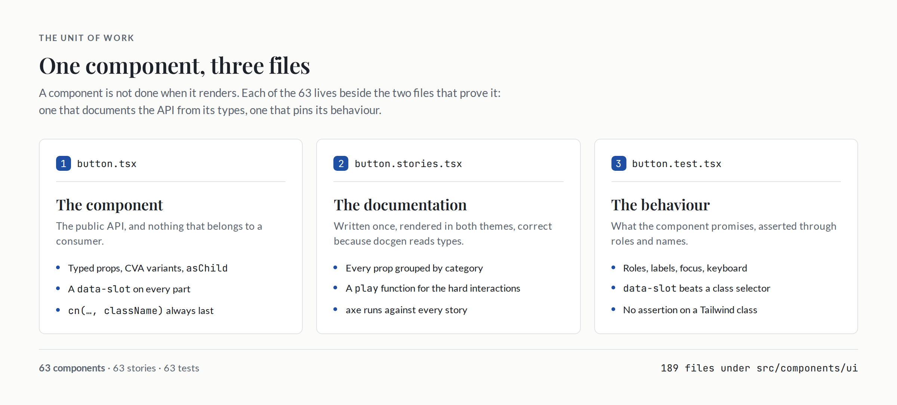
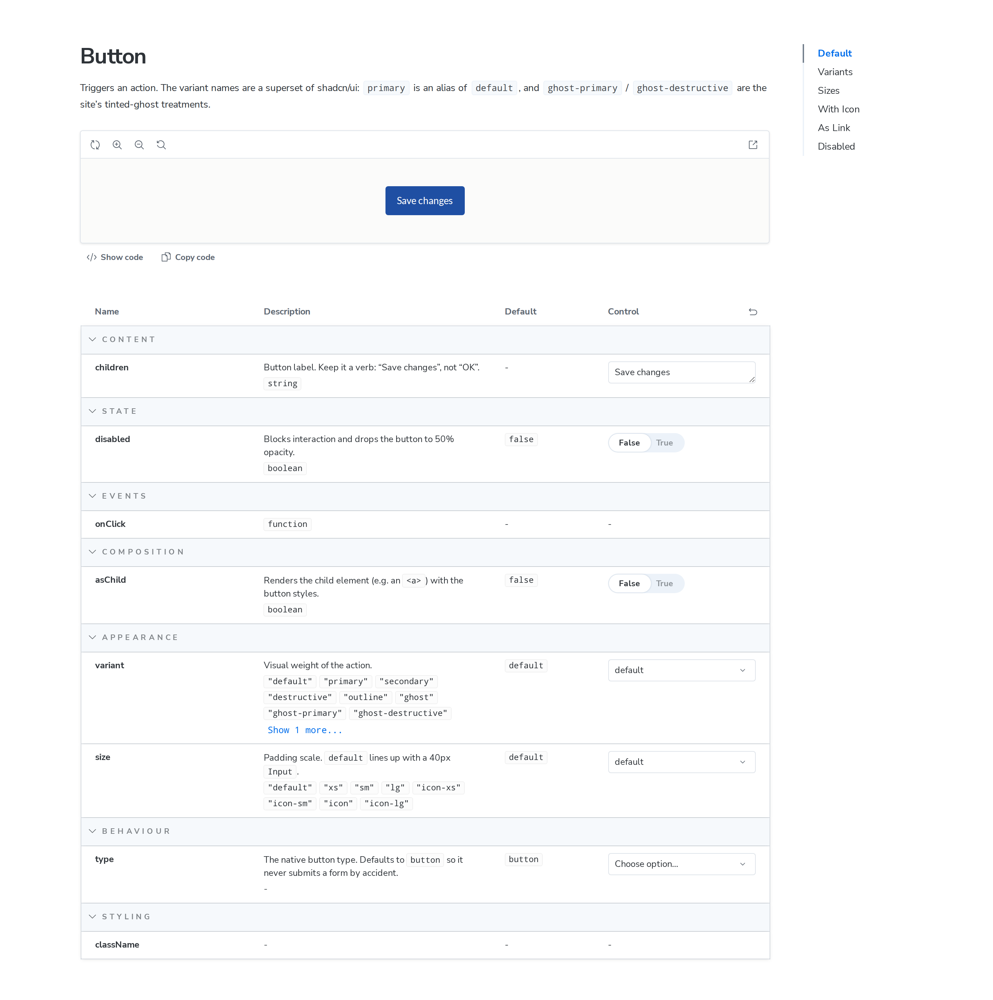
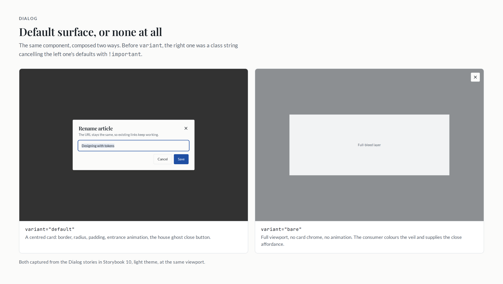

# The palette is not the product

Part 1 ended with the palette as the product and the components as the things that consume it. That is true about how the library looks. It is not true about how the library behaves: a token file cannot tell you whether a dialog returns focus when it closes, whether `variant` is a select or a text box in the docs, or whether a new component quietly joined the client bundle.

Sixty-three components is a small library by count and a large one by surface. Each has variants, sizes, slots, an accessibility contract, a dark theme, and a story that someone will read before using it. The interesting engineering is not any of those components. It is deciding what a component is, and then making the repository refuse anything that is not that.

This is the codebase half of the story. Part 1 was how the components were made to look like the site. This is how they were built, and how they have stayed consistent through four tagged releases.

## One component, three files

Every component is a unit of three files that live side by side:

```
src/components/ui/
  button.tsx
  button.stories.tsx
  button.test.tsx
```

There are 63 of each, 189 files, and the directory listing is the checklist. The pairing is deliberate in both directions. The story imports `./button`, so renaming or moving the component breaks the story in the same pull request. The test does the same. Nothing in the repository can describe a component that no longer exists, because the description lives next to it and the build sees it.

It also means a component is not "done" when it renders. It is done when the API is typed, the documentation is generated from those types, and the behaviour is pinned. A component with no story is visible as a missing file in a directory where the other 62 have one; a component with no test moves the coverage ratchet the wrong way, which is the subject of a later section.



_Figure 1 - The unit of work. A component is not finished until all three exist._

## Stories that document

A story in this repository is written like a small specification. The meta block declares the component, turns on autodocs, and describes every public prop: what it does, its default, and which group it belongs to.

```tsx
const meta = {
  title: 'Components/Button',
  component: Button,
  tags: ['autodocs'],
  parameters: {
    docs: {
      description: {
        component:
          'Triggers an action. The variant names are a superset of shadcn/ui: `primary` is an alias of `default`, and `ghost-primary` / `ghost-destructive` are the site’s tinted-ghost treatments.',
      },
    },
  },
  argTypes: {
    variant: {
      control: 'select',
      description: 'Visual weight of the action.',
      table: { category: 'Appearance', defaultValue: { summary: 'default' } },
    },
    size: {
      control: 'select',
      description: 'Padding scale. `default` lines up with a 40px `Input`.',
      table: { category: 'Appearance', defaultValue: { summary: 'default' } },
    },
    // …every other public prop, in the same shape
  },
};
```

The categories are the table of contents of the props table: Appearance, State, Behaviour, Accessibility, Composition, Content, Events, Styling, plus a component-specific Form, Data, Range, Layout or Validation where it earns its place. A reader who wants to know what changes the look never scrolls past what changes the state. That is documentation work, and it is the part no tool does for you.

What a tool should do is stop the docs from disagreeing with the types. Storybook's default docgen reads source with `react-docgen`, which cannot see through `cva`: a variant defined in a `class-variance-authority` call comes back as `string`, and the Controls panel degrades to a text box. The repository switches to the TypeScript-based extractor:

```ts
typescript: {
  // react-docgen cannot see through class-variance-authority, so the variant
  // unions would degrade to `string`. The TypeScript-based docgen reads the
  // real prop types, which is what makes the Controls panel accurate.
  reactDocgen: 'react-docgen-typescript',
  reactDocgenTypescriptOptions: {
    shouldExtractLiteralValuesFromEnum: true,
    shouldRemoveUndefinedFromOptional: true,
    savePropValueAsString: true,
    propFilter: (prop) => (prop.parent ? !/node_modules/.test(prop.parent.fileName) : true),
  },
},
```

That fixed most of it. The rest is a detail worth writing down, because it is the kind of thing that makes a good docs page look broken: `VariantProps` types every variant as `'default' | 'primary' | … | null`. `shouldRemoveUndefinedFromOptional` removes `undefined`, but not `null`. Every enum control therefore grew one empty option, and the props table printed `null` in the type column.

The tempting fix is to add `options` by hand to each argType. That is a second place to update whenever a variant is added, and it will eventually be wrong. The fix that was kept strips the member from the inferred union instead, in one enhancer that applies to every component:

```tsx
const withoutEmptyEnumValues: NonNullable<Preview['argTypesEnhancers']>[number] = ({
  argTypes,
}) => {
  const next = { ...argTypes };

  for (const [name, argType] of Object.entries(argTypes)) {
    if (argType?.type?.name !== 'enum') continue;

    const summary = argType.table?.type?.summary;

    next[name] = {
      ...argType,
      type: {
        ...argType.type,
        value: argType.type.value?.filter((value) => !isEmptyMember(value)),
      },
      // The docs table renders this precomputed union instead of `type.value`.
      ...(typeof summary === 'string' && {
        table: {
          ...argType.table,
          type: {
            ...argType.table?.type,
            summary: summary
              .split(' | ')
              .filter((member) => member !== 'null' && member !== 'undefined')
              .join(' | '),
          },
        },
      }),
    };
  }

  return next;
};
```

The component's type stays the single source of truth. Adding a variant updates the control, the table, and the union in the same edit, because all three are read from the same declaration.



_Figure 2 - The docs page for Button. The controls are grouped by category and `variant` is a select because docgen read the real union._

## The same stories also run

Storybook is where the design system is reviewed, so it is also where it is tested. The Vitest config has two projects. The first is jsdom, fast enough for every save. The second renders every story in a real browser:

```ts
{
  // Every story is a test: it must render, and its play function must pass.
  extends: true,
  plugins: [storybookTest({ configDir: fileURLToPath(new URL('./.storybook', import.meta.url)) })],
  test: {
    name: 'storybook',
    browser: {
      enabled: true,
      headless: true,
      provider: playwright(),
      instances: [{ browser: 'chromium' }],
    },
  },
}
```

`pnpm test:stories` starts that project, and every story in the repository becomes a test: it has to mount, and any `play` function has to finish. The accessibility addon runs axe against the rendered result, configured as a failure rather than a warning:

```ts
// Any axe violation fails `pnpm test:stories`.
a11y: { test: 'error' },
```

This catches what jsdom cannot. A Radix dialog positions itself with real layout, moves focus into the content, traps it there and returns it on close; a popover flips when it does not fit. In jsdom those are approximations, and an accessibility violation that only exists once CSS applies is invisible. Rendering in Chromium is also how a story that throws on mount, or a control combination nobody clicks by hand, fails before a consumer finds it.

The split is a cost decision as much as a correctness one: `pnpm test` stays a jsdom run measured in seconds, `pnpm test:stories` pays for a browser and runs in CI, where `playwright install --with-deps chromium` is an explicit step.

## Unit tests assert behaviour, not class strings

The jsdom tests test behaviour. Dialog is a good example because it has the most to get wrong: a trigger, a portal, a backdrop, focus movement, an accessible name, a close affordance, and a `bare` variant for consumers composing their own surface.

```tsx
function renderDialog(props: DialogContentProps = {}) {
  return render(
    <Dialog>
      <DialogTrigger>Open dialog</DialogTrigger>
      <DialogContent {...props}>
        <DialogHeader>
          <DialogTitle>Rename article</DialogTitle>
          <DialogDescription>The URL stays the same.</DialogDescription>
        </DialogHeader>
        <DialogFooter>Footer content</DialogFooter>
      </DialogContent>
    </Dialog>,
  );
}

it('opens on click and names itself from the title and description', async () => {
  renderDialog();

  await userEvent.click(screen.getByText('Open dialog'));

  const dialog = await screen.findByRole('dialog');
  expect(dialog).toHaveAccessibleName('Rename article');
  expect(dialog).toHaveAccessibleDescription('The URL stays the same.');
});
```

Class names are the design surface, and in this repository they are rewritten mechanically by `apply-house-style.mjs`; a test that pins one either freezes the design or fails on every restyle. So the default is to assert roles, accessible names and `data-slot` attributes. `data-slot="dialog-content"` exists because a test sometimes needs to find a part that has no role of its own, and because a stable hook is worth more than a selector built from three utilities.

There are a handful of deliberate exceptions, and they are the ones where the visual rule _is_ the contract. The table test asserts that a row carries `border-b` and no `shadow`; the checkbox asserts `rounded-sm`. Those are house rules - borders instead of shadows, one radius - and pinning them is the point. They are also the tests that will need editing when the house style changes, which is the trade: assert a design decision where it is a decision, and leave the rest to behaviour.

The same rule is why `DialogContent` sets `data-variant`, and why `button.tsx` sets `data-variant` and `data-size`. The tests read the semantic state, and the visual state is testable without asserting the class string that produced it.

## Coverage is a ratchet

Thresholds are usually a badge. Here they are a ratchet: the floor sits where the suite is today, so a new component without tests lowers the average and fails the run instead of sliding underneath a percentage nobody reads.

```ts
coverage: {
  provider: 'v8',
  include: ['src/components/ui/**/*.tsx', 'src/lib/**/*.{ts,tsx}', 'src/hooks/**/*.ts'],
  exclude: ['src/**/*.stories.tsx', 'src/**/*.test.tsx'],
  thresholds: {
    lines: 65,
    functions: 60,
    statements: 65,
    branches: 50,
    'src/hooks/**': { lines: 90, functions: 75, statements: 90, branches: 85 },
    'src/lib/**': { lines: 70, functions: 50, statements: 70, branches: 90 },
  },
},
```

The two overrides are the interesting part. A hook or a utility has logic: a listener that has to be unsubscribed, a breakpoint comparison, a string that gets a suffix. Those are held to 90 % and 70 %, because every line is a decision. The 63 components are mostly class strings and prop forwarding; holding them to the same number would buy assertions on markup rather than on behaviour, which the previous section argues against. The overall floor keeps them from being untested; the higher floors keep the parts with real logic honest.

## House props sit on top of upstream

The registry components are the starting point, not the API. The rule for changing one is that a house prop sits on top of upstream, never instead of it. `Button` keeps every shadcn variant and adds the site's own:

```ts
const buttonVariants = cva(
  'inline-flex shrink-0 cursor-pointer items-center justify-center gap-2 rounded-sm border border-transparent font-sans text-sm font-medium whitespace-nowrap focus-ring transition-colors disabled:pointer-events-none disabled:cursor-not-allowed disabled:opacity-50 [&_svg]:pointer-events-none [&_svg]:shrink-0 [&_svg:not([class*=size-])]:size-4',
  {
    variants: {
      variant: {
        default: 'bg-primary text-primary-foreground hover:bg-primary/90',
        primary: 'bg-primary text-primary-foreground hover:bg-primary/90',
        secondary: 'bg-secondary text-secondary-foreground hover:bg-secondary/80',
        destructive: 'bg-destructive text-destructive-foreground hover:bg-destructive/90',
        outline: 'border-border bg-background hover:bg-accent hover:text-accent-foreground',
        ghost: 'bg-transparent hover:bg-accent hover:text-accent-foreground',
        'ghost-primary': 'bg-transparent text-primary hover:bg-primary/10',
        'ghost-destructive': 'bg-transparent text-destructive hover:bg-destructive/10',
        link: 'text-primary underline-offset-4 hover:underline',
      },
      size: {
        default: 'px-4 py-2.5',
        xs: 'gap-1 px-2 py-1 text-xs [&_svg:not([class*=size-])]:size-3',
        sm: 'px-3 py-1.5 text-sm',
        lg: 'px-6 py-3',
        'icon-xs': 'p-1.5 [&_svg:not([class*=size-])]:size-3',
        'icon-sm': 'p-2',
        icon: 'p-2.5',
        'icon-lg': 'p-3',
      },
    },
    defaultVariants: {
      variant: 'default',
      size: 'default',
    },
  },
);
```

Sizing is padding-based rather than a fixed height, which is why `default` lines up with the 40px `Input` instead of matching a number in two files. The same pattern shows up across the library: `Badge` gains a `tag` variant for the muted pills the site uses on cards, `Card` gains `interactive` for cards that behave as links, and `Dialog` gains the composition props described below.

The harder half of the rule is what happens when a prop is wrong. `DialogContent` originally exposed `showCloseButton?: boolean`. It now takes `closeButton?: boolean | React.ReactNode`, so a consumer on a non-`bg-background` surface can supply a readable close affordance instead of hiding the default one. The boolean is still there, marked deprecated, and `closeButton` wins when both are set:

```tsx
/**
 * @deprecated Use `closeButton` instead. Kept so existing call sites keep
 * working; `closeButton` wins when both are set.
 */
showCloseButton?: boolean;
```

A design system that removes a prop has to break someone. A design system that keeps a deprecated alias for one minor version does not, and the type tells the next reader what to use.

## Composition over override

`Dialog` is where the registry's defaults were most expensive. The registry ships a centred card with a border, a radius, padding, a shadow and an entrance animation. An image viewer or a canvas wants none of that, and before `variant` existed the only way out was a class string cancelling each default with `!important` - at every call site, drifting with every change to the card.

The fix was to make the surface composable rather than overridable:

```tsx
/**
 * The bare layer: full viewport, none of the card chrome and no entrance
 * animation. A viewer that already covers the screen has nothing to fly in.
 */
const BARE_CONTENT_CLASS =
  'fixed inset-0 z-[var(--z-index-modal)] outline-none focus-visible:outline-none';

// excerpt: the composition props DialogContent accepts
type DialogContentProps = React.ComponentProps<typeof DialogPrimitive.Content> & {
  closeButton?: boolean | React.ReactNode;
  /** Classes for the backdrop. The layer is not otherwise reachable. */
  overlayClassName?: string;
  /** Render the backdrop at all. Defaults to `true`. */
  showOverlay?: boolean;
  variant?: 'default' | 'bare';
};
```

`variant="bare"` is the common case. `overlayClassName` reaches the backdrop that the component otherwise owns, `showOverlay` removes it, and `DialogContentPrimitive` is exported for a layout the props cannot express. The story for the full-bleed case is five lines of consumer code instead of a paragraph of overrides.



_Figure 3 - The same component, composed two ways. The bare layer keeps the behaviour - focus trap, Escape, aria wiring - and drops the surface._

The same principle produced the most instructive mistake in the project. `CardImage` first shipped with `src`, `alt` and an `imageComponent` prop, so a Next app could pass `next/image` and everyone else got an ``. It looked flexible. It was a leak: the package was now in the business of knowing about framework image components, it had to accept `fill` and map it, and every call site still had to guard the empty case because an aspect box with no media is never what you want.

The 0.2.0 release reverted it. `CardImage` is now a div with the aspect ratio and `overflow-hidden` that takes `children`, which is required on purpose:

```tsx
interface CardImageProps {
  aspect?: string;
  className?: string;
  /**
   * The media itself. Required on purpose: an aspect box with nothing in it is
   * never the intended result, and making it optional pushed every call site
   * into guarding the frame with its own conditional.
   */
  children: React.ReactNode;
}
```

A Vite app passes ``, an Astro app passes its own component, a Next app passes `next/image`. The library never imports a framework-specific image component, and the ratio stays the library's business. Making `children` required was a breaking change in a 0.x release, and it was the right one: the alternative was a prop that existed to apologise for a leaky abstraction.

## The client boundary is a test, not a convention

In a React Server Components tree, `'use client'` is a correctness boundary: a component that calls a hook or wraps a primitive without its own boundary has to carry the directive, or the consumer gets a runtime error. In a component library it is also a budget: every module marked as client moves into the client bundle.

The repository turns the rule into a test with four assertions, and the interesting one is the second direction - it fails when a module is marked unnecessarily:

```ts
function needsClient(source: string): boolean {
  return (
    /\buse[A-Z]\w*\s*\(/.test(source) || radixPrimitives(source).some((name) => name !== 'Slot')
  );
}
```

`Slot` is `asChild` plumbing with no behaviour, and Radix leaves it unmarked for exactly that reason. Modules that wrap a dependency which declares its own boundary (`cmdk`, `sonner`, `react-resizable-panels`, `@shadcn/react/questionnaire`) stay unmarked too, and the last test in the file re-checks that each of those packages still ships the directive - read out of `node_modules` at test time, so an upgrade that removes it fails here rather than in a consumer's app.

This rule was not obvious in advance. The 0.2.0 work started by marking every module with a Radix import, which is the safe-looking choice. It broke the most ordinary thing a consumer does:

```
Attempted to call buttonVariants() from the server
```

`button.tsx` exports both `Button` and `buttonVariants`. The directive is file-level, so marking the file made the plain function a client reference as well. Styling a `<Link>` from a server component - the standard `asChild` pattern - threw. The rule was narrowed to what genuinely needs a boundary: hook calls, and primitives that declare none themselves.

The trade is asymmetric, and the test encodes the asymmetry. A missing directive crashes a consumer at runtime; an unnecessary one costs a few kilobytes. So the line is drawn the way Radix draws it, and both directions are asserted.

## The read-through tests could not replace

The suite was green before the "10 UI library gaps" pass, which is the point. A suite proves that the behaviour someone thought to assert still holds. It does not prove that a component is complete.

That pass produced a commit whose subject lists ten gaps: `U1 success tokens, U2 CardTitle asChild, U3 CardImage imageComponent, U4 badge tag variant, U5 table whitespace, U6 lucide-react peer dep, U9 dialog blemishes`. Its diff touches three source files - `card.tsx`, `table.tsx`, `tokens.css` - plus their stories and tests, and a blank line in `package.json`. `CardTitle` gained the `asChild` it should have had from the start, so a card title can be an `<h3>` without losing the display face. The table's checkbox-cell selector moved from `[&:has([role=checkbox])]:pr-0` to `has-[[role=checkbox]]:pr-0`, which is the syntax Tailwind v4 actually needs. The `CardImage` prop changed, and was reverted a release later.

The rest of the list did not leave a diff: some items were already true, some were cosmetic, and one never landed. That is the lesson worth keeping. A commit subject is not a checklist, and a green build is not a review. The pass that found those gaps was a person reading the components against the site they had to serve, which is still the only process that catches "this component is technically fine and practically incomplete."

The 10-item list is also where the `CardImage` detour entered: it shipped as a fix in that pass and was reverted in 0.2.0, which is why the breaking change exists. A review that only adds is a review that never learns.

## What it costs

Sixty-three components, 189 files, a story and a test for each. The cost is real: writing the story is often longer than writing the component, and the coverage ratchet makes an untested addition expensive to ship. The return is that the repository answers most questions about itself. What does `variant` accept? Read the type. What does this component promise? Read the test. What does it look like in dark mode? Open the story.

None of that is visible in a screenshot of the library, which is why Part 1 could describe the design and stop. The next part is the other invisible half: how these 63 modules, their declarations and their stylesheet become one tarball that a consumer can install, and how that tarball gets published without a version being typed by hand.

# References:

- [misiekhardcore/konopskidevui](https://github.com/misiekhardcore/konopskidevui)
- [Storybook: TypeScript docgen](https://storybook.js.org/docs/api/main-config/main-config-typescript)
- [Storybook test addon](https://storybook.js.org/docs/writing-tests/integrations/storybook-test)
- [Vitest browser mode](https://vitest.dev/guide/browser/)
- [class-variance-authority](https://cva.style/docs)
