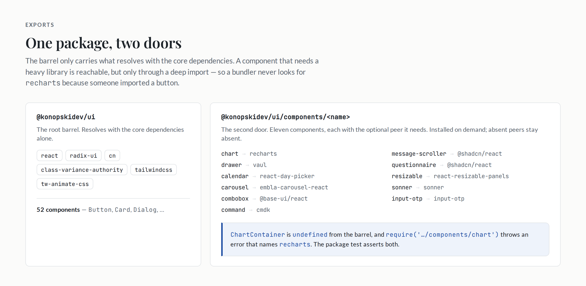
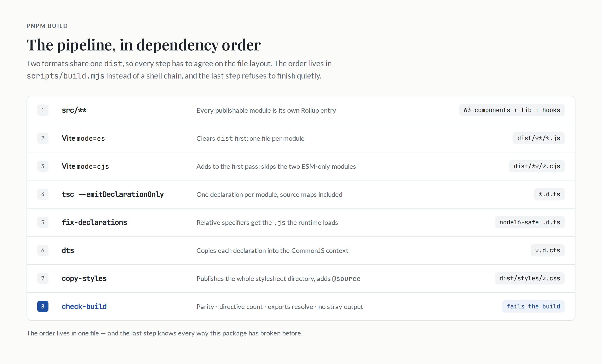
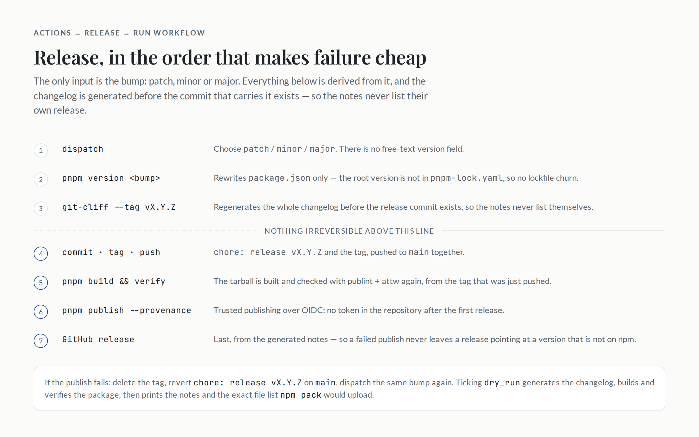

# The version that typed cleanly and did not work

`@konopskidev/ui@0.1.2` was on npm. It installed, it type-checked, and a consumer could not use it.

The 0.2.0 pull request opens with the post-mortem, and it is worth quoting in full because most of the checks in this article exist because of one of these sentences:

> The 0.1.2 tarball typed cleanly but could not be used as published: a CommonJS consumer (Jest included) could not resolve it at all, two modules shipped declarations with no JavaScript behind them, the stylesheet rendered components unstyled unless the app guessed a `node_modules` path, and every client module carried `'use client'` twice while 29 others that need it had none.

Four failures, four different layers of the package: the module graph, the declaration graph, the stylesheet, and the client boundary. None of them is visible in the source, in the type-checker, or in a component test. They only exist in the artifact.

That is the lesson this part is about. A component library is not the code in `src`. It is the tarball someone installs, and the only way to trust the tarball is to test the tarball.

## One entry per module

The first failure came from the build's entry list. Rollup emits what an entry reaches, and the build used to be driven by `src/index.ts` alone. Two modules - `lib/highlighter` and `hooks/use-highlighted-code` - were exported through a wildcard subpath but never re-exported from the barrel. `tsc` wrote their declarations, Rollup wrote no JavaScript, and the subpath typed perfectly while throwing at runtime.

The fix is to stop treating reachability as the entry definition:

```js
/**
 * The build's entry points.
 *
 * Rollup only emits what an entry reaches. Driving the build from `src/index.ts`
 * alone silently dropped modules that are exported through a wildcard but never
 * re-exported from the barrel (`lib/highlighter`, `hooks/use-highlighted-code`):
 * `tsc` wrote their `.d.ts`, rollup wrote no JavaScript, and the subpath typed
 * fine while failing at runtime.
 *
 * Making every publishable module its own entry keeps the one-file-per-module
 * layout without depending on reachability. Rollup's own documentation recommends
 * this over `output.preserveModules` when the goal is to preserve a file tree.
 */
export function discoverEntries() {
  const entries = walk(SRC)
    .filter((file) => /\.tsx?$/.test(file) && !EXCLUDED.some((rule) => rule.test(file)))
    .map((file) => path.relative(SRC, file).split(path.sep).join('/'))
    .sort();

  return Object.fromEntries(
    entries.map((relative) => [relative.replace(/\.tsx?$/, ''), path.join(SRC, relative)]),
  );
}
```

Every `.ts` and `.tsx` file under `src` becomes an input, except tests and stories. One module in, one file out, so `@konopskidev/ui/components/button` is a single component rather than the whole library.

The same file holds the exception list:

```js
/**
 * Modules that can only ship as ESM, so the CommonJS pass skips them and the
 * `exports` map lists them without a `require` condition. `shiki` has no
 * CommonJS build (`main` is `dist/index.mjs`), so a `.cjs` copy would throw the
 * moment a consumer required it.
 */
export const ESM_ONLY_MODULES = ['lib/highlighter', 'hooks/use-highlighted-code'];
```

Two modules out of 69 have no CommonJS build. That is enough to make "every module in both formats" the wrong rule, and enough to make the exception explicit rather than accidental.

## Two passes, one `dist`

The package ships ESM and CommonJS. Both come from the same Vite config, run twice:

```ts
/**
 * `pnpm build` runs this config twice, once per mode: `es` writes `dist/**/*.js`
 * and clears the directory, `cjs` adds `dist/**/*.cjs` next to it. Two passes
 * rather than two outputs because the CommonJS one ships a smaller entry set.
 */
export default defineConfig(({ mode }) => {
  const format = mode === 'cjs' ? 'cjs' : 'es';
  const extension = format === 'es' ? '.js' : '.cjs';

  return {
    build: {
      lib: {
        entry: format === 'es' ? discoverEntries() : discoverCjsEntries(),
        formats: [format],
      },
      outDir: 'dist',
      // The second pass adds to the first pass's output instead of removing it.
      emptyOutDir: format === 'es',
      rollupOptions: {
        external: (id) =>
          id.includes('node_modules') || (!id.startsWith('.') && !id.startsWith('/')),
        output: {
          entryFileNames: `[name]${extension}`,
          chunkFileNames: `chunks/[name]-[hash]${extension}`,
        },
      },
      sourcemap: true,
      minify: false,
    },
  };
});
```

The order matters: the ESM pass owns the directory and clears it, the CommonJS pass adds to what is already there. The `external` predicate keeps every bare specifier out of the bundle - a component library must not vendor React, Radix or `recharts` - and only the interop helpers become a shared chunk.

Minification is off. A minified library is a debugging tax on everyone who installs it, and the consumer's bundler minifies the whole application anyway.

## Declarations in two module contexts

TypeScript reads a declaration in the module context implied by its extension. A dual package therefore needs two declaration sets with identical types: `.d.ts` for the `import` branch and `.d.cts` for the `require` branch.

`tsc` emits only the first. The build generates the second by copying each declaration and pointing its relative specifiers at the `.cjs` files beside it:

```js
const source = fs
  .readFileSync(file, 'utf8')
  // The `.map` files are not copied, so the reference would dangle.
  .replace(/^\/\/# sourceMappingURL=.*$/gm, '')
  .replace(/(['"])(\.{1,2}\/[^'"]*)\.js\1/g, (match, quote, specifier) => {
    return `${quote}${specifier}.cjs${quote}`;
  });
```

There is a second, subtler rewrite before that one. `tsc` copies relative specifiers verbatim, but the JavaScript Rollup emits uses explicit extensions. Node's ESM resolver and `attw`'s `node16` check both require the declaration to name the file the runtime will actually load:

```js
function resolveExtension(fromFile, specifier) {
  if (!specifier.startsWith('.')) return specifier;
  if (/\.[cm]?jsx?$|\.json$|\.css$/.test(specifier)) return specifier;

  const target = path.resolve(path.dirname(fromFile), specifier);
  const candidates = [`${target}.d.ts`, path.join(target, 'index.d.ts')];

  return candidates.some((candidate) => fs.existsSync(candidate)) ? `${specifier}.js` : specifier;
}
```

Both rewrites exist for the same reason: a declaration that resolves to a file the runtime does not load is worse than no declaration, because it type-checks and then fails.

## One package, two doors

The `exports` map is the package's public shape. The interesting part is not that it has both formats; it is that two families of entry points behave differently.

```json
{
  "exports": {
    ".": {
      "import": { "types": "./dist/index.d.ts", "default": "./dist/index.js" },
      "require": { "types": "./dist/index.d.cts", "default": "./dist/index.cjs" }
    },
    "./components/*": {
      "import": { "types": "./dist/components/ui/*.d.ts", "default": "./dist/components/ui/*.js" },
      "require": {
        "types": "./dist/components/ui/*.d.cts",
        "default": "./dist/components/ui/*.cjs"
      }
    },
    "./styles.css": "./dist/styles/globals.css",
    "./package.json": "./package.json"
  }
}
```

The map above is abridged: `lib/*`, `hooks/*` and the two ESM-only subpaths follow the same shape, one entry per module. The root barrel carries 52 components - everything that resolves with the core dependencies. The other eleven are deep-import only, because each needs a heavy optional peer: `chart` needs `recharts`, `drawer` needs `vaul`, `calendar` needs `react-day-picker`, `carousel` needs `embla-carousel-react`, `combobox` needs `@base-ui/react`, `command` needs `cmdk`, `input-otp` needs `input-otp`, `resizable` needs `react-resizable-panels`, `sonner` needs `sonner`, and `message-scroller` and `questionnaire` need `@shadcn/react`.

The barrel is generated from the directory, and the policy lives in the generator:

```js
/** Component → the optional peer it needs. Mirrors the README table. */
const OPTIONAL_PEER_COMPONENTS = [
  'calendar', // react-day-picker
  'carousel', // embla-carousel-react
  'chart', // recharts
  'combobox', // @base-ui/react
  'command', // cmdk
  'drawer', // vaul
  'input-otp', // input-otp
  'message-scroller', // @shadcn/react
  'questionnaire', // @shadcn/react
  'resizable', // react-resizable-panels
  'sonner', // sonner
];
```

`pnpm barrel` rebuilds `src/index.ts` from that list. A new component that needs a new peer is one line in one file, and the barrel cannot silently start re-exporting `recharts` because someone imported a button.

The other half is how the failure surfaces. `peerDependenciesMeta` marks each of those optional, so installing the package does not install them. Import a deep path without its peer, and the failure names what is missing rather than dying inside a bundler.



_Figure 1 - Two doors. The barrel resolves with the core dependencies; the heavy peers are reachable only from the subpath that needs them._

## The stylesheet is part of the API

The third failure was the quietest. `styles.css` used to resolve into `src`, so a packaging change could break it without breaking a component import. And Tailwind does not scan `node_modules`: a consumer who imported the stylesheet got a component with no utilities generated, no build error, and no console warning. Every component rendered unstyled, and the only signal was visual.

The fix publishes the stylesheet from `dist` like everything else, copies the whole directory rather than one file, and appends the package's own source registration to the copy:

```js
const SOURCE_REGISTRATION = `
/*
 * Register this package's own modules as Tailwind sources.
 *
 * Tailwind does not scan \`node_modules\`, so without these lines every component
 * renders unstyled with no error anywhere. The paths are relative to this file,
 * which is why they work from a consumer's install without configuration.
 */
@source '../components';
@source '../lib';
@source '../hooks';
`;
```

Two details are load-bearing. The whole directory is copied because `globals.css` imports its siblings by relative path (`./tokens.css`, `./prose.css`, …), and a lone copy would resolve to nothing. The `@source` block is appended to the **copy**, not to `src/styles`, because Tailwind resolves `@source` against the file that declares it: inside `dist/styles` those paths point at the package's own `dist`, so the registration cannot drift from the layout and the consumer never has to know where the package lives in `node_modules`.

Keeping it out of `src` matters for a second reason. Storybook compiles the source stylesheet directly, from a checkout where `dist` may not exist. A `@source` line pointing at `../components` relative to `src/styles` would mean the sample app and the published package compile against different rules. The build writes the registration into the artifact that needs it, and the source stays a stylesheet.

## The build tests itself

The four failures are now four categories of assertion. `scripts/build.mjs` ends with `check-build`, which runs against `dist` rather than the source, because `dist` is what consumers install:

```js
/**
 * The build's own test, run by `pnpm build` and again by `pnpm verify`.
 *
 * Every rule here exists because the published tarball got it wrong once:
 *
 * - `lib/highlighter.js` and `hooks/use-highlighted-code.js` were missing while
 *   their declarations shipped, so the subpath typed fine and threw at runtime.
 * - `textarea.js` carried `'use client'` twice, and `dialog.js` not at all.
 * - `styles.css` resolved into `src`, where nothing else did.
 */
```

Parity checks that every entry produced the files its module type implies - `.js`, `.cjs`, `.d.ts`, `.d.cts`, minus the ESM-only pair. The directive check reads the source's first line, then asserts the emitted file carries exactly one `'use client'`, on the first statement, and none when the source has none. The exports check walks every entry in `package.json` and asserts the target exists, sampling wildcard families with a known module (`components/button`, `lib/utils`, `hooks/use-mobile`). A final check rejects any output that no entry accounts for, with one exception for the shared CommonJS interop chunk.

Then there is the check that publint and `attw` cannot make: `scripts/test-package.mjs` installs the packed tarball into a throwaway consumer and uses it as an application would.

It runs `npm pack`, extracts the tarball into a scratch directory, and symlinks **only** the core dependencies. The heavy peers are deliberately absent, which is what makes the barrel assertion meaningful:

```js
const ui = require('@konopskidev/ui');
assert.equal(typeof ui.Button, 'function');
assert.equal(typeof ui.Card, 'function');
assert.equal(typeof ui.Dialog, 'function');
assert.equal(typeof ui.Table, 'function');
assert.equal(typeof require('@konopskidev/ui/components/button').Button, 'function');
assert.equal(typeof require('@konopskidev/ui/components/card').CardImage, 'function');
// …the lib and hooks subpaths, and the same assertions for the ESM entry

// A component whose peer is not installed stays out of the barrel…
assert.equal(ui.ChartContainer, undefined, 'chart must not be re-exported from the root');

// …and asks for that peer only when its deep import is used.
assert.throws(
  () => require('@konopskidev/ui/components/chart'),
  /recharts/,
  'the chart must report its missing optional peer',
);
```

The same script builds a Tailwind stylesheet that imports nothing but `@konopskidev/ui/styles.css`, then asserts the output contains utilities that only the components use - `z-[var(--z-index-modal)]`, `data-slot`, `rounded-sm`. That is the test for the failure with no error message: if the package's `@source` breaks, this build emits CSS without the component classes, and the check fails instead of a consumer shipping an unstyled page.

The metadata validators run last:

```bash
publint && attw --pack . --profile node16 --exclude-entrypoints ./styles.css ./lib/highlighter ./hooks/use-highlighted-code
```

`attw` with the `node16` profile validates both the `import` and `require` branches of every entry, which is exactly the class of bug that made 0.1.2 unusable. The three exclusions are honest: `styles.css` is a plain asset, and the two ESM-only modules have no `require` branch to validate.

All of it runs in one command, in the order the pieces depend on each other:

```bash
pnpm verify   # lint → tsc → test → build → test:package → publint + attw
```



_Figure 2 - Eight steps, one `dist`. The order lives in `scripts/build.mjs` instead of a shell chain, so the two formats cannot disagree about the layout._

## Release without a version field

The release workflow is dispatch-only, and the only input is the bump:

```yaml
on:
  workflow_dispatch:
    inputs:
      version_bump:
        description: 'Version bump type'
        required: true
        type: choice
        default: patch
        options:
          - patch
          - minor
          - major
      dry_run:
        description: 'Build, verify and preview the changelog without tagging or publishing'
        required: false
        type: boolean
        default: false
```

There is no free-text version field, so a release is always the next version in sequence. The bump is applied with `pnpm version --no-git-tag-version`, which rewrites `package.json` only - the root version is not recorded in `pnpm-lock.yaml`, so there is no lockfile churn to commit.

The changelog is generated before the release commit exists:

```yaml
- name: Generate the changelog
  uses: orhun/git-cliff-action@v4
  with:
    config: cliff.toml
    args: --verbose --tag "v${{ steps.version.outputs.version || '0.0.0-preview' }}"
```

`--tag` labels everything merged since the previous tag with the new version. Running it first means the release notes never list their own `chore: release` commit, and regenerating the file in full keeps older releases instead of overwriting them.

Then the workflow commits `package.json` and `CHANGELOG.md`, tags `vX.Y.Z`, pushes both, builds the library, runs `verify:package` again against the tag that was just pushed, publishes with provenance, and creates the GitHub release last. Each ordering decision is a failure it prevents:

- **Push before publish** means the tag exists when npm records the provenance.
- **Publish before the GitHub release** means a failed publish never leaves a release pointing at a version that is not on the registry.
- **Verify between build and publish** means the tarball is checked in the release job, not only on `main`.
- **`concurrency: release`, not cancel-in-progress** means two dispatches cannot interleave a version bump.

Authentication is npm trusted publishing over OIDC, with `id-token: write`. Every release after the first needs no secret. The first one does, because npm only exposes trusted-publisher settings for a package that already exists: either create `0.1.0` by hand and then add the publisher, or add a granular `NPM_TOKEN` and let the workflow do it.

There is also a `dry_run` input. It generates the changelog, builds and verifies the package, then prints the notes and the exact file list `npm pack` would upload - without committing, tagging, publishing or releasing. It is the difference between trusting the workflow and having run it.



_Figure 3 - Release order. The changelog exists before the commit that carries it, and the GitHub release is last._

## Using it

What a consumer sees is deliberately small. Install the package, and the peers for the components you actually use:

```bash
pnpm add @konopskidev/ui
pnpm add recharts            # only if you import @konopskidev/ui/components/chart
```

Wire the stylesheet once, with no `@source` line of your own:

```css
/* app.css */
@import 'tailwindcss';
@import '@konopskidev/ui/styles.css';
```

Dark mode is the `.dark` class on any ancestor, usually `<html>`, set by the app. The `--font-*` variables come from the app as well - the site sets them with `next/font` - and every style has a fallback, so a Vite app that never defines them still looks right.

Components that call hooks or wrap a client-only primitive carry `'use client'` and render inside a React Server Components tree. The ones that do not - `Card`, `Badge`, `Button`, `Table`, `Input` and the rest of the hook-free wrappers - stay server-compatible, which is what makes it possible to style a `<Link>` with `buttonVariants()` from a server component.

Jest needs no configuration. Because CommonJS ships alongside ESM, `require('@konopskidev/ui')` resolves directly: no `moduleNameMapper`, no transform for the package, no `transformIgnorePatterns` exception. That is the whole reason the CommonJS pass exists.

One practical note that is not about code: pnpm quarantines packages published in the last 24 hours. While you are the one publishing and testing the install, add the package to `minimumReleaseAgeExclude` in `pnpm-workspace.yaml`, or the install will wait a day for a release you just made.

## What the pipeline buys

A release here is boring, and that is the point. The version is not typed, the changelog is not written, the tarball is not trusted: each is derived from the one before it and checked before the next step runs. When something does go wrong, the failure is a failed run rather than a version number that cannot be reused - npm versions are immutable, so the recovery is delete the tag, revert the release commit, dispatch the same bump again.

The four failures in 0.1.2 were not exotic. They were an entry list, a declaration context, a stylesheet path and a directive count. All four were invisible to the compiler and to the component tests, and all four are now invisible to nobody: the build refuses to finish without checking them.

That is the whole shape of the project. Part 1 made the components look like the site. Part 2 made them behave like a library. This part made the tarball something a stranger can install - and the checks are the argument.

# References:

- [misiekhardcore/konopskidevui](https://github.com/misiekhardcore/konopskidevui)
- [Node.js: packages and `exports`](https://nodejs.org/api/packages.html#package-entry-points)
- [Are the types wrong? (`attw`)](https://arethetypeswrong.github.io/)
- [publint](https://publint.dev/)
- [npm trusted publishing](https://docs.npmjs.com/trusted-publishers)
- [git-cliff](https://git-cliff.org/)
- [Tailwind CSS: detecting classes in source files](https://tailwindcss.com/docs/detecting-classes-in-source-files)
